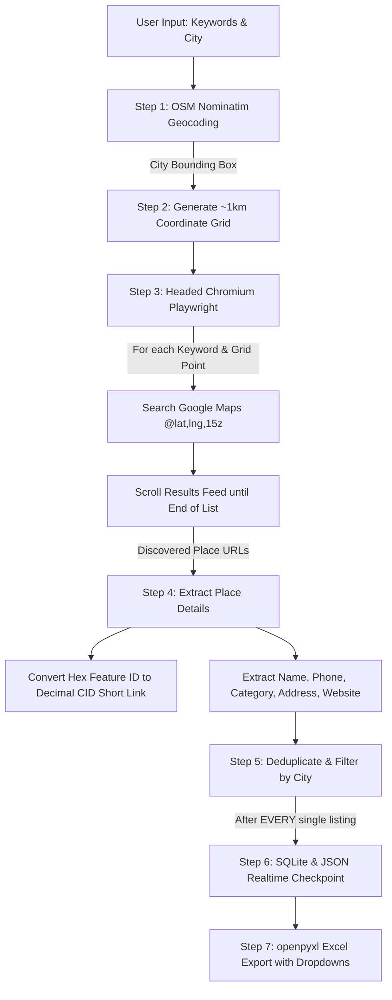

# 🗺️ Google Maps Leads Extractor (Free & Local)

A free, local Python automation tool built with **Playwright (Chromium, headed mode)** and **OpenStreetMap Nominatim** to extract high-quality business leads directly from Google Maps—with **zero paid APIs**, **zero subscription fees**, **automated 1-km search grid sampling**, **decimal CID short link conversion**, and **Excel export with interactive dropdowns**.

---

## ✨ Features

- 🆓 **100% Free & Local**: No Google Maps API keys or third-party paid scraping services required.
- 🌐 **OpenStreetMap Bounding Box Geocoding**: Queries OpenStreetMap Nominatim for the target city boundaries automatically.
- 📐 **~1 km Search Grid Sampling**: Divides the city bounding box into ~1 km coordinate points and searches `https://www.google.com/maps/search/<keyword>/@<lat>,<lng>,15z` to bypass Google Maps' 120-result viewport cap and discover all local listings.
- 📜 **Infinite Results Feed Scrolling**: Scrolls Google Maps' left-hand results panel dynamically until the *"You've reached the end of the list"* message is reached.
- 🏢 **Deep Business Information Extraction**:
  - **Business Name**
  - **Phone Number**
  - **Category / Business Type**
  - **Address**
  - **Website URL**
  - **Google Maps Place URL**
  - **Decimal CID Short Link** (`https://maps.google.com/?cid=<decimal>`)
  - **Rating & Review Count**
- 🔗 **Hex-to-Decimal CID Conversion**: Converts embedded 64-bit hexadecimal identifiers (`0x...:0x<hex>`) into permanent, clean Google Maps decimal CID short links.
- 🎯 **Deduplication & City Filtering**: Deduplicates entries by CID and optionally filters out businesses outside the target city.
- ⏱️ **Human-like Delays & Anti-Bot Protection**: Randomized 1–3 second delays between actions, single browser context, and standard viewport simulation.
- 🚨 **Interactive CAPTCHA Handling**: Automatically detects Google bot protection or CAPTCHA pages, rings an audible alert in the terminal, pauses the script, and waits for you to solve it in the headed Chromium window before resuming seamlessly.
- 💾 **Per-Listing SQLite & JSON Checkpointing**: Every single lead is saved immediately to `leads.db` and synchronized with `leads.json`. You can stop and restart the scraper at any time without losing data or repeating work.
- 📊 **Styled Excel Export (`openpyxl`)**:
  - **Headers**: `Business Name`, `Phone`, `Google Maps URL`, `Business Type`, `Call Status`, `Interest`, `Send`
  - **Interactive Dropdowns** on every row:
    - `Call Status`: `answered` | `unanswered` | `call back`
    - `Interest`: `interested` | `not interested`
    - `Send`: `send` | `not send`
  - **Styled Navy Header Row**, **Frozen Top Row (A2)**, **Auto-Filters**, and **Clickable Hyperlinks**.

---

## 📋 System Requirements

- **Python 3.8+** (Python 3.10, 3.11, or 3.12 recommended)
- **Windows, macOS, or Linux**

---

## 🚀 Quick Start & Installation

### 1. Clone or Open the Project Directory

```bash
cd leads-extractor-google-maps
```

### 2. Create and Activate a Virtual Environment

**On Windows (PowerShell):**
```powershell
python -m venv .venv
.venv\Scripts\Activate.ps1
```

**On macOS / Linux:**
```bash
python3 -m venv .venv
source .venv/bin/activate
```

*(If using `uv`: `uv venv && .venv\Scripts\activate`)*

### 3. Install Python Dependencies

```bash
pip install -r requirements.txt
```

### 4. Install Playwright Chromium Browser

```bash
playwright install chromium
```

---

## 💻 Usage

### Option A: Interactive Mode (Recommended for Beginners)

Simply run `main.py` without arguments:

```bash
python main.py
```

The interactive wizard will guide you through entering:
1. **Keyword(s)** (e.g. `plumber, electrician, hvac`)
2. **City Name** (e.g. `Austin, TX` or `Miami, FL`)
3. **Grid Step Size** (default `1.0` km)
4. **City Filter** (`Y`/`N`)
5. **Output File Path** (default `leads_export.xlsx`)

---

### Option B: Command-Line Flags

```bash
# Single keyword search
python main.py -k "dentist" -c "Austin, TX" -o "austin_dentists.xlsx"

# Multiple keywords
python main.py -k "plumber" "electrician" "roofing contractor" -c "Seattle, WA" --step-km 1.0 -o "seattle_contractors.xlsx"

# Disable strict city filtering
python main.py -k "coffee shops" -c "Portland, OR" --no-filter-city -o "portland_coffee.xlsx"

# Limit maximum leads (e.g., 50 leads for a test run)
python main.py -k "gym" -c "Miami, FL" --limit 50 -o "miami_gyms.xlsx"
```

### Available CLI Options

| Flag | Short | Default | Description |
|---|---|---|---|
| `--keywords` | `-k` | *Interactive* | One or more search keywords |
| `--city` | `-c` | *Interactive* | Target city name (e.g. `Austin, TX`) |
| `--step-km` | | `1.0` | Grid spacing in kilometers (~1 km) |
| `--filter-city` | | `True` | Filter businesses whose address doesn't contain target city |
| `--no-filter-city` | | `False` | Allow businesses in adjacent areas / metro |
| `--output` | `-o` | `leads_export.xlsx` | Output Excel `.xlsx` file path |
| `--db` | | `leads.db` | SQLite checkpoint database |
| `--json` | | `leads.json` | JSON realtime backup |
| `--limit` | | `None` | Optional limit on total unique leads to scrape |

---

## 🌐 Interactive Web Dashboard

Launch the local web dashboard anytime:
```bash
python app.py
# Or double-click: Start_Leads_Extractor.bat
```
Visit **`http://localhost:5000`** in any web browser.

### 🌟 Dashboard Capabilities:
1. **📁 Multi-Section Search Batches**:
   - Preserves all past search batches (e.g. `Hospitals • Nanded`, `Cafes • Nanded`, `Dental • Nanded`) as separate tabs.
   - Switch between sections with a single click without losing or mixing past leads.
   - Export or delete individual search batches independently.
2. **🏷️ AI Category Analysis & 3-4 Subcategories Section**:
   - Analyzes all leads in the active section and classifies them into **3-4 intuitive industry categories** (e.g. For Hospitals: *General Hospitals*, *Dental Care*, *Eye Care*, *Specialist Clinics*; For Cafes: *Cafes & Coffee Shops*, *Fast Food*, *Regional Dining*, *Bars & Grills*).
   - Interactive category cards with percentage bars for instant filtering.
   - Smart Categories Dropdown with macro-sections and specific Google Maps categories.
3. **☑️ Multi-Select & Bulk Operations**:
   - Checkboxes on every lead row and master select-all header.
   - Floating action toolbar for **Bulk Delete**, **Bulk Export**, and **One-Click Phone Number Copying** for WhatsApp/SMS campaigns.
4. **🗑️ Instant Lead Deletion & Live State Sync**:
   - Individual lead deletion with instant SQLite removal and smooth row fade-out.
   - Live synchronization with status polling to prevent deleted leads from reappearing.
5. **📊 Safe Streaming Excel Downloads**:
   - Direct in-memory workbook generation prevents Windows file-locking permission errors if Excel is open.


---

## 🛠️ How It Works (Step-by-Step Architecture)



1. **City Bounding Box**: Calls OpenStreetMap Nominatim with a dedicated User-Agent to retrieve `[south, north, west, east]` bounding coordinates.
2. **Coordinate Grid**: Converts km distance into geodesic latitude/longitude steps using Haversine formulas and creates coordinate centers ~1 km apart.
3. **Google Maps Search & Infinite Scroll**: Opens `https://www.google.com/maps/search/<keyword>/@<lat>,<lng>,15z` in headed Chromium and scrolls `div[role="feed"]` until *"You've reached the end of the list"* (`div.HlvSq`) is encountered.
4. **Place Detail Extraction**: Visits listing pages and extracts structured business data, including phone numbers from action buttons / text patterns.
5. **Hex-to-Decimal CID Conversion**: Parses the 64-bit hex feature ID from the URL (e.g. `0xd134e199e405a163`) and converts it to unsigned decimal (`15074921903787712867`) to produce permanent short links (`https://maps.google.com/?cid=15074921903787712867`).
6. **Checkpointing & Resume**: SQLite (`leads.db`) and JSON (`leads.json`) are updated after every single listing. If interrupted (e.g., computer reboot, internet drop), re-running the script resumes from the exact point left off.
7. **Excel Export**: Generates an Excel workbook styled with custom fonts, colors, frozen headers, and pre-configured dropdowns for outreach pipelines.

---

## 📊 Excel Output Structure

| Business Name | Phone | Google Maps URL | Business Type | Call Status | Interest | Send |
|:---|:---:|:---|:---|:---:|:---:|:---:|
| Austin Plumbing Pros | +1 512-555-0199 | [https://maps.google.com/?cid=...](https://maps.google.com/?cid=15074921903787712867) | Plumber | *[Dropdown]* | *[Dropdown]* | *[Dropdown]* |
| Lone Star HVAC | +1 512-555-0844 | [https://maps.google.com/?cid=...](https://maps.google.com/?cid=1234567890123456789) | HVAC Contractor | *[Dropdown]* | *[Dropdown]* | *[Dropdown]* |

### Pre-Configured Row Dropdowns:
- **Call Status**: `answered` • `unanswered` • `call back`
- **Interest**: `interested` • `not interested`
- **Send**: `send` • `not send`

---

## 🚨 CAPTCHA & Bot Protection Handling

If Google temporarily shows a CAPTCHA or *"Our systems have detected unusual traffic"*:
1. The script will pause immediately and trigger an audible alert in your console.
2. A message will appear:
   ```
   🚨 CAPTCHA / Unusual Traffic Detected in Chromium!
   Please switch to the Chromium window, solve the CAPTCHA manually.
   When solved and the page loads, return here and press [ENTER] to resume...
   ```
3. Simply solve the CAPTCHA in the visible Chromium browser window, return to your terminal, and press `[Enter]`. The script will verify that the page is clear and resume scraping automatically.

---

## 🧪 Running Unit Tests

To verify that all components (CID converter, geocoder, SQLite database, and openpyxl Excel exporter) are functioning:

```bash
python test_components.py
```

---

## 📁 Project Structure

```
leads-extractor-google-maps/
├── config.py              # Central configuration, selectors, delays, and constants
├── geo.py                 # OSM Nominatim geocoding & ~1km grid generator
├── cid_utils.py           # Hex-to-decimal CID extraction & short URL builder
├── db.py                  # SQLite database manager & JSON auto-sync checkpointing
├── scraper.py             # Playwright Chromium scraper engine & CAPTCHA handling
├── exporter.py            # openpyxl Excel generator with dropdown validations & styling
├── progress_logger.py     # Rich console & file logger (scraper.log)
├── main.py                # CLI entry point and interactive runner
├── test_components.py     # Automated verification test suite
├── requirements.txt       # Python dependencies
└── README.md              # Documentation and guide
```

---

## ⚖️ License & Disclaimer

This tool is created for local research and public business contact discovery. Please comply with Google Maps Terms of Service and local data regulations when using automated tools.
